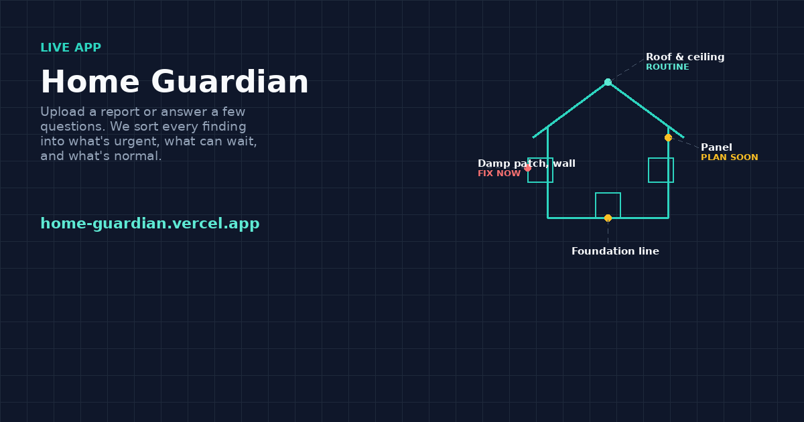
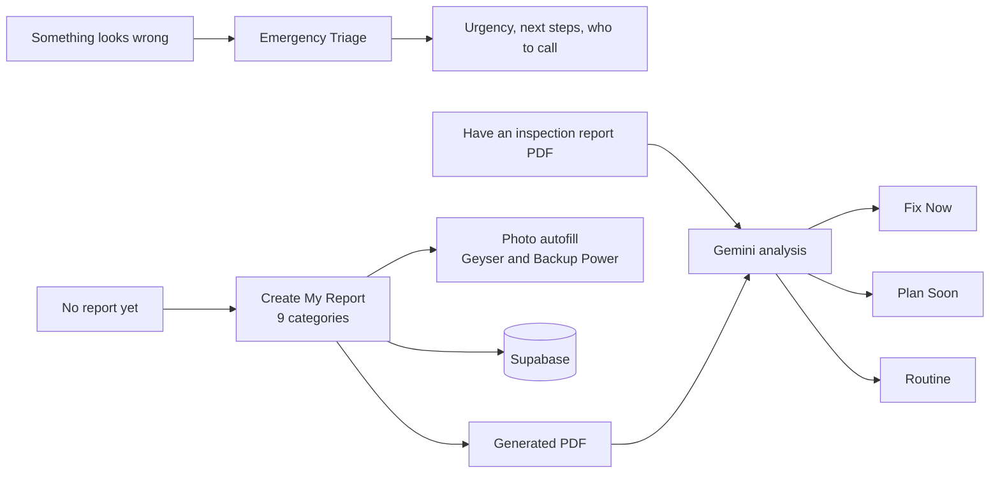

<div align="center">



# Home Guardian

### Your house, explained.

Know what's serious. Know what to do.


**[Open the live app](https://home-guardian.vercel.app)**

</div>

---

## The problem

Most first-time homeowners in Pakistan never see a formal inspection report. So when a damp patch shows up on the ceiling at 1am, the options are a relative's opinion, a forum thread, or a bad feeling.

Home inspection tools exist, but they were built for markets where inspections are already normal. Home Guardian is built for the ones where they are not.

## What it does

Three tools, one idea: turn "I have no idea" into "here is what to do first."

| Tool | You bring | You get |
|---|---|---|
| **Is this an emergency?** | A house problem | Instant advice on urgency, what to do right now, and who to call |
| **Report Reader** | An inspection report PDF | Every finding sorted into **Fix Now**, **Plan Soon** or **Routine**, each explained in one plain sentence |
| **Create My Report** | Nothing. No report needed | A guided 9-category check-up that becomes a downloadable PDF, then flows straight into the Report Reader |

## How it fits together



The part worth noticing: **Create My Report feeds the same analyzer** as an uploaded PDF. One click on "Analyze This Report Now" and the generated report is read without any download or re-upload.

## Sorted by what matters

| Urgency | Meaning |
|---|---|
| **Fix Now** | A safety or damage risk. Do this first |
| **Plan Soon** | Not an emergency, but it gets worse and costs more if ignored |
| **Routine** | Normal wear and maintenance. Keep an eye on it |

## Built for Pakistani homes

The 9 categories in Create My Report were researched for how homes here actually work, not copied from US inspection checklists.

| Category | Why it is here |
|---|---|
| Water Supply | Overhead and underground tanks, motors and pumps, pressure |
| Geyser | Gas, electric, solar or hybrid, plus age and condition |
| Electrical | Wiring age, exposed wiring, frequent tripping |
| Backup Power | UPS, generator and solar setups |
| Plumbing and Drainage | Leaks and clogging |
| Structural | Cracks: where and how big |
| Roof and Ceiling | Seepage and water stains |
| Dampness and Ventilation | Damp patches and poor airflow |
| Doors, Windows and Security | Locks, broken glass and screens |

### Photo autofill

On the **Geyser** and **Backup Power** steps, take a photo (live camera) or upload one. Gemini reads the nameplate or the unit and fills in the matching answers. You review and change anything before moving on.

It fills what it can see and leaves the rest as "Not sure". For example, a geyser's age often is not printed anywhere, so that field may come back unsure. That is the honest answer, not a bug.

## Built with

| Layer | Tech |
|---|---|
| Framework | Next.js (App Router) |
| Styling and motion | Tailwind CSS, Framer Motion |
| AI | Google Gemini, for report analysis and photo reading |
| Database | Supabase (Postgres) |
| PDF | jsPDF, generated in the browser |
| Hosting | Vercel |
| App install | PWA manifest, installable on phone and desktop |

The look is a deliberate blueprint: deep navy, teal lines, an animated grid, and urgency colors only where they carry meaning.

## Run it locally

```bash
git clone https://github.com/abdullah-zeshan/home-guardian.git
cd home-guardian
npm install
```

Create a `.env.local` file in the project root:

```bash
GEMINI_API_KEY=your_gemini_key
NEXT_PUBLIC_SUPABASE_URL=your_supabase_project_url
NEXT_PUBLIC_SUPABASE_ANON_KEY=your_supabase_anon_key
```

Create the `reports` table in Supabase, with Row Level Security on and an insert-only policy (the form only ever adds reports, it never reads them back):

```sql
create table reports (
  id bigint generated always as identity primary key,
  created_at timestamptz default now(),
  owner_name text,
  address text,
  findings jsonb  -- all 9 categories of answers
);

alter table reports enable row level security;

create policy "Allow public insert"
  on reports for insert
  to public
  with check (true);
```

Then start it:

```bash
npm run dev
```

Open [http://localhost:3000](http://localhost:3000).

## Project layout

```
src/app/
  page.js               homepage and "how it works" graphic
  emergency/            "Is this an emergency?" triage
  report/               PDF upload and AI analysis
  create-report/        the 9-step wizard, PDF export, photo autofill
  api/analyze/          sends a report PDF to Gemini
  api/analyze-photo/    reads a geyser or backup-power photo
  sitemap.js            sitemap for search engines
src/lib/supabase.js     Supabase client
public/manifest.json    PWA manifest and icons
```

## Know the limits

- Home Guardian is an **explainer, not a licensed inspector**. It helps you understand a problem and decide what to do first. For anything structural, electrical or gas-related, call a qualified professional.
- AI readings can be wrong or unsure. Every autofilled answer is editable.
- Report data is stored without accounts, so do not put anything in it you would not want kept.

## Made by

**Abdullah Zeshan**, a solo build.
[LinkedIn](https://linkedin.com/in/abdullah-zeshan-4706a02a3) · [GitHub](https://github.com/abdullah-zeshan) · [Portfolio](https://abdullahzeshan.site)

<div align="center"><sub>A house should come with an explanation. Most don't.</sub></div>
